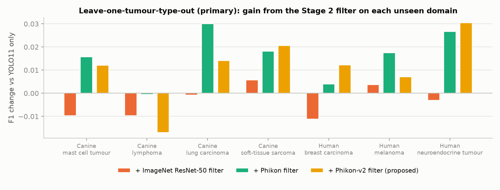
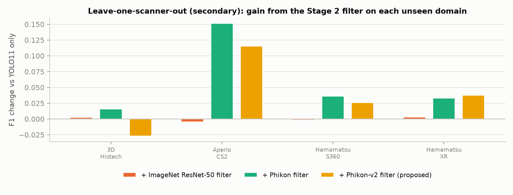
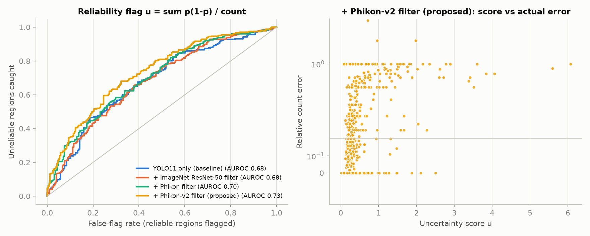

# MitoGuard

**Imposter-aware, scanner-robust mitotic figure counting with calibrated uncertainty.**

MitoGuard counts mitotic figures in H&E tumour regions from scanners and tumour types it has never
seen. It rejects the look-alike "imposter" cells that cause most false alarms, and it reports every count
with a calibrated 90% interval and a grade-ambiguity flag that tells the pathologist when to look.

## Headline results (MitoGuard v2, held-out domains only, MIDOG++)

| | YOLO11 only | MitoGuard v1 | **MitoGuard v2** |
|---|---|---|---|
| **Unseen scanner**: F1, 503 regions [95% CI] | 0.510 [0.467, 0.552] | 0.537 | **0.714 [0.686, 0.740]** |
| **Unseen tumour type**: F1, 503 regions [95% CI] | 0.760 [0.740, 0.778] | 0.765 | **0.778 [0.758, 0.795]** |
| Gain over YOLO11, unseen scanner (paired bootstrap) | – | +2.7 | **+20.5 [17.2, 24.2]**, p < 0.001 |
| Gain over YOLO11, unseen tumour type | – | +0.5 | **+1.8 [1.3, 2.3]**, p < 0.001 |
| Count agreement with pathologists (CCC), unseen scanner | 0.45 | 0.51 | **0.85** |
| Mitotic-count category agreement (quadratic κ), unseen scanner | 0.55 | 0.56 | **0.80** |
| Category accuracy when *not* flagged, unseen tumour type | 99.5% | 99.5% | **99.6%** |
| Imposters counted as mitoses, unseen tumour type | 6.4% | 5.2% | **5.1%** |
| Calibration error (ECE) of mitosis probabilities, unseen tumour type | 0.060 | 0.034 | **0.017** |

All model selection uses nested leave-one-domain-out validation (a fold's own held-out domain never
influences its configuration). On the MIDOG++ paper's own test regions, v2 reaches **0.754 F1 on unseen
tumour types vs 0.666** for the published RetinaNet baseline, and **0.792 vs 0.719** in-domain
([details](#comparison-with-published-results-v2)).

## What is new in v2

1. **Fine-tuned pathology foundation models as cell classifiers.** Phikon-v2 (ViT-L), Phikon (ViT-B)
   and Lunit DINO (ViT-S/8) are adapted with LoRA (rank 16, attention projections only, backbone frozen).
   The classifier reads out the cell itself: the crop is zoomed to the central 112 px and the CLS token is
   concatenated with the mean of the central patch tokens. Training uses GPU domain randomisation:
   per-sample H&E optical-density jitter, brightness/contrast/saturation, focus blur, dihedral
   transforms, plus translation and scale jitter that mimic detector localisation error. Inference uses
   8-view TTA, and the three models are averaged in logit space.
2. **Detector union.** Each fold's two YOLO11 detectors (with and without stain augmentation) propose
   candidates together. Boxes YOLO labels as *imposter* stay in the pool, because under domain shift
   true mitoses are often filed there. This lifts the candidate recall ceiling on the hardest unseen
   scanner from 0.78 to 0.84 (0.89 with the widest pool).
3. **"Detectors propose, the foundation model decides".** The deployed configuration does not fuse in
   YOLO's confidence, which is exactly the signal that degrades under scanner shift. That is why v2
   holds up on unseen scanners: F1 0.71 vs 0.51.
4. **Conformal count intervals and a grade-ambiguity flag.** The count's Poisson-binomial spread
   (Σ p(1−p) from calibrated probabilities) is calibrated into a 90% interval by normalised split-conformal
   prediction on training-domain regions. A region is flagged when its interval straddles a mitotic-count
   category cut-off (≤7 / 8–14 / ≥15 per ~2 mm²). Unflagged regions are categorised correctly 99.6% of
   the time, and the flag catches 99% of category errors on unseen tumour types.
5. **Honest model selection and statistics.** Nested leave-one-domain-out selection (DomainBed-style),
   paired bootstrap confidence intervals over regions, and candidate-level calibration on held-out domains.
6. **Site adaptation (optional deployment mode).** Self-training on a new site's unlabelled candidates.
   It helps on most sites, but a fixed pseudo-label budget failed on a low-prevalence site; see
   [site adaptation](#site-adaptation-honest-results).

## MitoGuard v2 results


Full tables: [`results/v2/summary_v2.md`](results/v2/summary_v2.md) (per-domain F1, nested selection,
bootstrap, clinical metrics) and [`results/v2/calibration.md`](results/v2/calibration.md).

**Per-domain F1 (held-out, nested selection).**

| Unseen tumour type | YOLO11 | v2 | | Unseen scanner | YOLO11 | v2 |
|---|---|---|---|---|---|---|
| Canine mast cell tumour | 0.814 | 0.812 | | 3D Histech (+3 unseen tumours) | 0.451 | **0.620** |
| Canine lymphoma | 0.745 | 0.758 | | Aperio CS2 | 0.326 | **0.812** |
| Canine lung carcinoma | 0.621 | 0.658 | | Hamamatsu S360 (pure scanner shift) | 0.721 | **0.771** |
| Canine soft-tissue sarcoma | 0.797 | 0.822 | | Hamamatsu XR | 0.741 | **0.775** |
| Human breast carcinoma | 0.747 | 0.773 | | | | |
| Human melanoma | 0.799 | 0.824 | | | | |
| Human neuroendocrine tumour | 0.706 | 0.748 | | | | |

**Clinical agreement of region counts** (503 held-out regions per protocol):

| | Unseen tumour: YOLO11 | Unseen tumour: **v2** | Unseen scanner: YOLO11 | Unseen scanner: **v2** |
|---|---|---|---|---|
| Count MAE (mitoses per region) | 6.25 | **5.90** | 14.73 | **8.33** |
| Lin's concordance (CCC) | 0.913 | **0.921** | 0.452 | **0.849** |
| Bland–Altman bias [95% limits] | −4.7 [−31, 22] | **−4.5 [−30, 21]** | −14.4 [−71, 42] | **−6.4 [−41, 28]** |
| Category accuracy (≤7 / 8–14 / ≥15) | 81.9% | **83.1%** | 66.2% | **79.9%** |
| Quadratic-weighted κ | 0.861 | 0.858 | 0.552 | **0.800** |
| Conformal 90% interval coverage | 0.81 | 0.80 | 0.59 | **0.76** |
| Naive ±1.645σ coverage (no conformal step) | 0.54 | 0.57 | 0.33 | 0.55 |
| Category accuracy when not flagged | 99.5% | **99.6%** | 79.9% | **94.2%** |

Under strong shift, conformal coverage stays below the nominal 90% (0.76 on unseen scanners): exchangeability
between training and target domains does not hold. Even so, the conformal step lifts coverage from 0.33–0.57
(naive intervals) to 0.76–0.80. Treat intervals on a new scanner as optimistic.

**Calibration** on unseen tumour types (candidate level): ECE 0.017 for the fine-tuned classifier, vs 0.034
for the v1 frozen filter and 0.060 for YOLO's raw scores.


### Comparison with published results (v2)

| F1 on the official MIDOG++ test regions | MIDOG++ paper (RetinaNet) | YOLO11 only | **MitoGuard v2** |
|---|---|---|---|
| Tumour type unseen (mean of 7) | 0.666 | 0.738 | **0.754** |
| In-domain reference (mean of 7) | 0.719 | 0.790 | **0.792** |

* Our leave-one-out folds train on the other tumours' test-split regions too (~25% more data than the
  paper). The in-domain row uses the paper's training data.
* A 2025 MIDOG entry (VM-UNet + stain augmentation) reports 0.736 mean F1 over whole held-out domains, with
  selection on the held-out domain. MitoGuard v2 reaches 0.771 (nested selection, no access to the held-out
  domain).
* Challenge leaderboards use hidden test sets and are not comparable. No state-of-the-art claim.
* Inter-pathologist agreement on mitotic figures is itself limited, and in-domain F1 here is already ~0.80.
  The largest remaining gains are on unseen scanners, which is exactly where v2 moves the needle.

### Site adaptation (honest results)

Site adaptation fine-tunes the classifier on the new site's own unlabelled candidates (class-balanced
self-training, one round, mixed 1:1 with labelled source crops). It is a **deployment mode**, transductive on
the target site's unlabelled images, so it is reported separately from the pure no-adaptation results.

| Held-out regions, F1 [95% CI] | Unseen tumour type | Unseen scanner |
|---|---|---|
| YOLO11 only | 0.760 | 0.510 |
| MitoGuard v2, no adaptation (primary) | 0.778 [0.758, 0.795] | 0.714 [0.686, 0.740] |
| + self-training, fixed budget (**pre-specified**) | 0.772 [0.753, 0.789] | 0.623 [0.591, 0.652] |
| + self-training, prevalence-aware budget (**post-hoc**) | **0.783 [0.764, 0.800]**, 7/7 folds beat YOLO | **0.762 [0.744, 0.779]**, 4/4 folds |

* **Pre-specified version failed on one site.** The fixed budget (top 10% of candidates as pseudo-mitoses)
  broke on the Hamamatsu XR site (F1 0.58 vs 0.78 without adaptation). That site includes neuroendocrine
  tumours, where imposters outnumber mitoses 3:1. The true mitosis share was far below 10%, so
  self-training taught the model that imposters are mitoses: classic confirmation bias.
* **Prevalence-aware fix (designed after seeing this failure, hence post-hoc).** The pseudo-positive budget
  becomes 70% of the site's *expected* mitosis count, estimated from validation-calibrated probabilities.
  On the neuroendocrine site it estimates 770 mitoses among 12,821 candidates (true count: 639). With this
  budget, adaptation beats YOLO on all 11 held-out domains and gives the best counts on unseen scanners
  (CCC 0.93, κ 0.85, conformal coverage 0.81). Because the fix was designed after observing a test-domain
  failure, treat these numbers as promising rather than confirmatory. They need a fresh site to confirm.

## Why this matters

The mitotic count is a core input to tumour grading in human and veterinary pathology. Models trained in
one lab miscount in another, and they mostly fail by **mistaking imposters for mitoses**: dying cells,
dark nuclei and other look-alikes. In MIDOG++, imposters outnumber true mitoses (14,349 vs 11,937). A lab
cannot install a model trained elsewhere and trust its numbers. It needs a detector that holds up on its
scanner, and a warning when it does not.

## v1 method (frozen foundation-model filter; baseline and ablations)

```
H&E region ──► 512 px tiles ──► Stage 1: YOLO11s (classes: mitosis, imposter; H&E stain augmentation)
                                   │  keeps BOTH class scores per box
                                   │  candidate pool: p_mitosis ≥ 0.05  or  p_imposter ≥ 0.10
                                   ▼
            224 px crop ──► zoom to central 112 px ──► frozen Phikon-v2 (ViT-L, pathology FM)
                                   │  feature = [CLS token ‖ mean of the central 4×4 patch tokens]
                                   ▼
            Stage 2: 5-MLP ensemble (Platt-calibrated) → p_filter
                                   │
            learned stacker  p = σ(w·[logit p_filter, logit p_mitosis, logit p_imposter])
                                   │
             ┌─────────────────────┴──────────────────────┐
             ▼                                            ▼
   count = #{p ≥ t}                    reliability  u = Σ p(1−p) / count  →  flag if u ≥ τ
```

* **Stage 1 (candidates).** YOLO11s is fine-tuned on 512×512 tiles with two classes, mitotic figure
  and imposter. H&E stain augmentation jitters each pixel in haematoxylin–eosin optical-density space.
  Inference uses overlapping tiles and keeps **both** class scores for every box. Under domain shift
  YOLO often files true mitoses under its *imposter* class, so the candidate pool also includes those
  boxes. This raises the pool's recall ceiling from ~0.87 to ~0.96.
* **Stage 2 (imposter filter on a frozen foundation model).** Each candidate is embedded once. The key
  design point is the **cell-centred read-out**. At 0.25 µm/px a mitotic figure covers ~50 of 224
  pixels, so the usual CLS token mostly describes the surrounding tissue. Zooming to the central
  112 px and adding the mean of the ViT's central 4×4 patch tokens raises the filter's validation AP
  from 0.77 to 0.90. An MLP ensemble is trained on labelled mitoses, labelled imposters and Stage 1's
  own false positives (hard negatives).
* **Learned stacker.** A 3-feature logistic regression combines the filter with YOLO's two class
  scores. It is fitted on *validation* candidates only, because on its own training cases YOLO is
  over-confident and a stacker fitted there would learn to over-trust it.
* **Count and reliability flag.** The count is the number of kept candidates. Treating each candidate
  as Bernoulli(p), the count variance is Σ p(1−p). Normalised by the count, it is high when many
  borderline candidates support a small count.
* **No peeking.** Within every fold, 20% of the *training-domain* cases form a validation set. That set
  is used for all model selection, feature design, calibration, stacking and thresholds. The held-out
  domain is touched only once, for the final numbers. `docs/experiment_log.md` records every design
  decision together with the validation evidence behind it.

## Evaluation protocol

The project brief asked us to check scanner/tumour confounding before training (`docs/data_audit.md`).
In MIDOG++ the two are strongly linked (Cramér's V = 0.77). Every tumour type except human breast cancer
was scanned on exactly one device, and the CSV's "5 scanners" are really 4 (one is a spelling variant).
So:

| Protocol | Folds | What it measures |
|---|---|---|
| **Leave-one-tumour-out (primary)** | 7 | new tumour type (often with a new lab/scanner) |
| Leave-one-scanner-out (secondary) | 4 | new scanner; the S360 fold (breast only) is a pure scanner shift |
| In-domain reference | 1 | official train/test split; quantifies the domain gap |

Detection F1 uses the official MIDOG matching (7.5 µm radius, converted per image from the TIFF
resolution) through `score_detection` from `grand-challenge-metrics` (the renamed `evalutils` package
that the MIDOG evaluation calls). TP/FP/FN are pooled over the cases of a set, as in the challenge.

## v1 results

All numbers are on held-out domains. Every threshold, calibration, stacker and design choice was fixed
on validation cases from the training domains. Full tables: [`results/summary.md`](results/summary.md).
Per-fold rows: `results/folds.csv`. Per-region rows: `results/cases.csv.gz`.

### Unseen tumour types (primary protocol)



| Held-out tumour | YOLO11 only | + ImageNet ResNet-50 | + Phikon | **+ Phikon-v2 (proposed)** |
|---|---|---|---|---|
| Canine mast cell tumour | 0.814 | 0.804 | 0.830 | **0.826** |
| Canine lymphoma | 0.745 | 0.736 | 0.745 | **0.728** |
| Canine lung carcinoma | 0.621 | 0.620 | 0.651 | **0.635** |
| Canine soft-tissue sarcoma | 0.797 | 0.802 | 0.815 | **0.817** |
| Human breast carcinoma | 0.747 | 0.736 | 0.751 | **0.760** |
| Human melanoma | 0.799 | 0.803 | 0.817 | **0.807** |
| Human neuroendocrine tumour | 0.706 | 0.703 | 0.733 | **0.737** |
| **Mean** | 0.747 | 0.744 | 0.763 | **0.758** |

All three filters share the same candidate pool and learned stacker, so the columns differ only in the
features. **ImageNet features give no gain; pathology foundation-model features do.**

### Unseen scanners (secondary protocol)



| Held-out scanner | YOLO11 only | + ImageNet ResNet-50 | + Phikon | **+ Phikon-v2** |
|---|---|---|---|---|
| 3D Histech (3 canine tumours, all unseen) | 0.451 | 0.454 | 0.467 | 0.424 |
| Aperio CS2 (breast + mast cell tumour) | 0.326 | 0.321 | 0.477 | 0.441 |
| Hamamatsu S360 (breast only: pure scanner shift) | 0.721 | 0.720 | 0.758 | 0.747 |
| Hamamatsu XR (breast, NET, melanoma) | 0.741 | 0.744 | 0.774 | 0.778 |

### What drives the gain: Stage 2 design ablation

| Stage 2 design (mean held-out F1) | Unseen tumour | Unseen scanner |
|---|---|---|
| YOLO11 only | 0.747 | 0.560 |
| ImageNet ResNet-50 filter alone (brief's design) | 0.651 | 0.635 |
| Phikon CLS-token filter alone (brief's design) | 0.668 | 0.577 |
| Phikon **cell-centred** read-out, filter alone | 0.725 | 0.628 |
| + learned stacker with YOLO scores | 0.757 | 0.614 |
| + wide candidate pool | **0.763** | **0.619** |

The filter as specified in the brief (MLP on the CLS token) is *worse* than YOLO alone. YOLO's explicit
imposter class already removes most imposters, and the CLS token of a 224 px crop describes tissue
context, not the ~50 px cell. Reading out the cell itself (zoom + centre patch tokens) is what makes the
frozen foundation model useful (filter validation AP 0.77 → 0.90).

### Why the foundation model generalises: detector-free probe

A linear probe on frozen features of all 26,286 labelled cells is trained on 6 tumour types and tested on
the 7th (mitosis vs imposter AUROC, mean over 7 held-out tumours):

| Features | AUROC | Scanner predictable from features (breast cancer only, chance 33%) |
|---|---|---|
| ImageNet ResNet-50 | 0.591 | 99% |
| ImageNet ResNet-50, zoomed | 0.643 | 99% |
| Phikon CLS | 0.754 | 100% |
| **Phikon cell-centred** | **0.876** | 100% |
| Phikon-v2 cell-centred | 0.872 | 100% |

Both feature families still encode the scanner perfectly. So the foundation model does **not**
generalise because it ignores the scanner. It generalises because its mitosis-vs-imposter direction stays
consistent across domains.


### Count-reliability flag



u = Σ p(1−p) / count picks out regions whose count is off by more than 20% with AUROC **0.73**
(Phikon-v2), against 0.68 for the same score built on YOLO's own probabilities. Per unseen tumour it
ranges from 0.62 (soft-tissue sarcoma) to 0.88 (lymphoma).

### Stain augmentation (ablation)

H&E optical-density jitter in Stage 1 gave **no consistent benefit**: mean change −0.008 F1 for YOLO
over the 7 tumour folds. In one scanner fold (Aperio CS2), the augmented detector's candidate recall
collapsed (0.49 vs 0.77 without augmentation), on both tumour types scanned there. With a single
training run per setting we cannot separate this from seed variance, so we report it rather than explain it.

### Comparison with published results

| Held-out F1 on the official MIDOG++ test regions | MIDOG++ paper (RetinaNet)¹ | YOLO11 only | MitoGuard + Phikon | MitoGuard + Phikon-v2 |
|---|---|---|---|---|
| Tumour type unseen (mean of 7) | 0.666 | 0.738 | 0.756 | 0.746 |
| In-domain reference (mean of 7) | 0.719 | 0.790 | 0.803 | 0.806 |

* ¹ Aubreville et al. 2023, Tables 4 and 6. Same test regions and matching rule. Their numbers average 5
  cross-validation models. Our leave-one-out models also trained on the test-split regions of the
  *other* six tumours (about 25% more data). The in-domain row uses the same training data as the paper.
* A 2025 MIDOG entry (VM-UNet + stain augmentation, Percannella et al.) reports 0.736 mean F1 under
  leave-one-domain-out over whole held-out domains, with model selection on the held-out domain itself.
  Ours is **0.758–0.763** on whole held-out domains, with no selection on the held-out domain.
* MIDOG challenge leaderboard scores come from hidden test sets and are **not** comparable. We make
  no state-of-the-art claim.
* Most of the margin over the 2023 paper comes from a stronger detector (YOLO11). The two-stage filter
  adds +1.1 to +1.6 F1 on top of that.


## Model card

Intended use, subgroup performance and failure modes: [`docs/model_card.md`](docs/model_card.md).

## Repository layout

```
mitoguard/        library: data & folds, tiling, stain augmentation, detector, features, Stage 2,
                  reliability scores, metrics, end-to-end pipeline
scripts/          numbered workflow: download → tiles → train → detect → embed → stage 2 → evaluate → report
app/app.py        Gradio demo (+ example regions from the MIDOG++ test split, CC0)
slurm/            SLURM job scripts used on the cluster
results/          tables (summary.md, folds.csv, cases.csv) and figures
docs/             data audit, experiment log, 2-page write-up
tests/            unit tests for the dataset-independent pieces
```

## Reproduce

```bash
pip install -r requirements.txt --extra-index-url https://download.pytorch.org/whl/cu121
export MIDOG_ROOT=/data/midogpp MITOGUARD_WORK=/data/mitoguard_work

python scripts/download_midogpp.py --out $MIDOG_ROOT          # ~70 GB, CC0
python scripts/make_tiles.py                                   # 88.5k tiles + pixel spacing
python scripts/data_audit.py                                   # scanner x tumour table, folds
python scripts/train_yolo.py --fold loto_HBC                   # one run per fold (+ --no-stain-aug)
python scripts/detect_all.py                                   # candidates for every finished run
python scripts/embed_crops.py --backbones phikon phikon2 resnet50 phikon_tta
python scripts/run_stage2.py --runs $(ls $MITOGUARD_WORK/cands | sed 's/.pkl//')
python scripts/evaluate.py && python scripts/make_report.py
python scripts/feature_analysis.py --umap
python scripts/export_bundle.py                                # v1 bundle → checkpoints/mitoguard_bundle.pt

# --- v2 ---
python scripts/cache_crops.py                                  # 224 px crop cache for fine-tuning
python scripts/make_union_cands.py                             # merge the two detectors per fold
python scripts/finetune_stage2.py --fold loto_HBC --backbone phikon2 --self-train   # per fold x backbone
python scripts/finetune_stage2.py --fold loto_HBC --backbone phikon2 --self-train-only --st-budget prevalence
bash slurm/final_v2.sh                                         # ensembles, evaluation, nested selection,
                                                               # bootstrap CIs, clinical metrics, calibration
python scripts/export_bundle_v2.py                             # → checkpoints/mitoguard_v2_bundle.pt
python app/app.py                                              # demo (uses the v2 bundle if present)
pytest                                                         # unit tests
```

On a SLURM cluster: `slurm/queue_worker.sh` is a resumable pull-based training queue, `slurm/ft_folds.sh`
fine-tunes a backbone on all folds, and `slurm/final_v2.sh` runs the complete v2 evaluation.

## Limitations

* MIDOG++ regions are pre-selected regions of interest; whole-slide hotspot search is out of scope.
* Reliability AUROC is measured against a 20% relative-error target. For regions with very few mitoses
  that target is strict (one miss in a region with 3 mitoses is 33%).
* Under domain shift the bottleneck is **recall**, not precision (held-out precision ~0.87, recall ~0.68):
  unseen domains make true mitoses look *less* mitotic to every model, so thresholds tuned in-domain are
  too strict. Label-free threshold adaptation is the obvious next step.
* One training run per configuration. Fold-to-fold differences of ~0.01 F1 are within run-to-run noise.
* Some cluster nodes carry GPUs not supported by the pinned PyTorch 2.5.1/cu121 build. Those jobs were
  excluded (`--exclude=cn07`).
* Research tool, not a medical device. No clinical validation.

## References

* Aubreville et al., *A comprehensive multi-domain dataset for mitotic figure detection*, Scientific Data 2023 (MIDOG++).
* Filiot et al., *Scaling self-supervised learning for histopathology with masked image modeling* (Phikon), 2023.
* Lafarge & Koelzer, *Fine-grained hard-negative mining*, MIDOG 2022 (3rd place).
* Ruifrok & Johnston, *Quantification of histochemical staining by color deconvolution*, 2001.

Data: MIDOG++ (CC0). Code: MIT.
