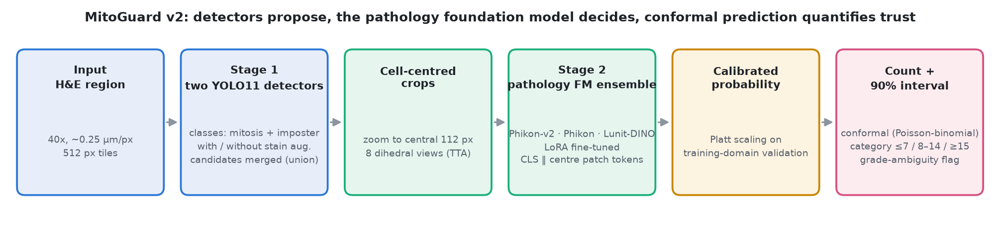
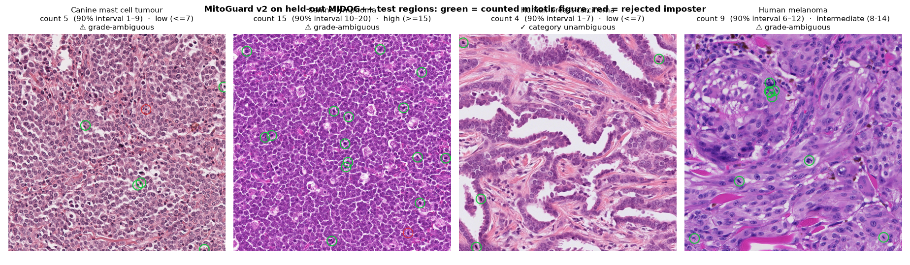
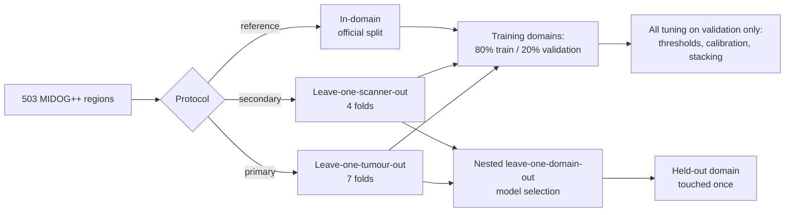
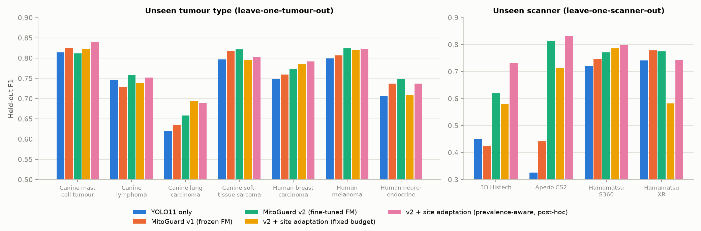
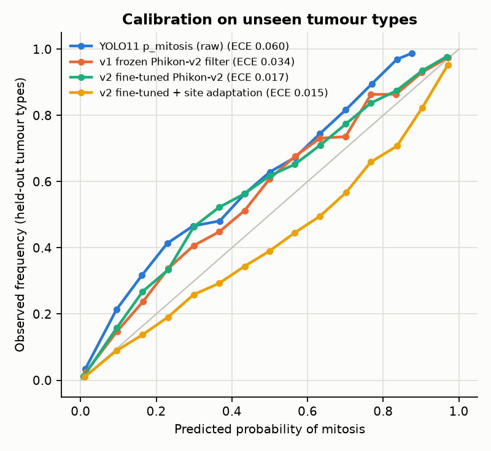
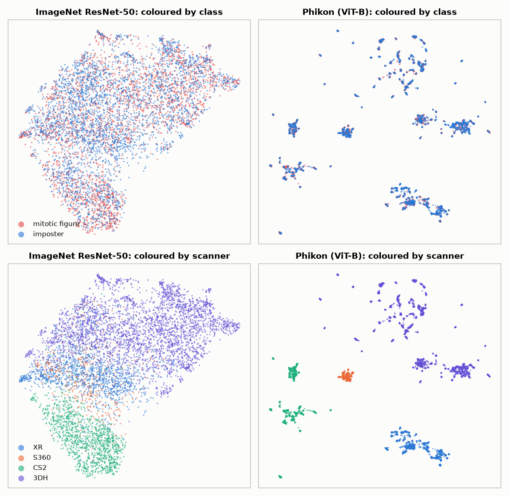

# MitoGuard: Project Report

**Imposter-aware, scanner-robust mitotic figure counting with calibrated uncertainty**

Live demo: https://huggingface.co/spaces/itskushal0403/MitoGuard · Code: https://github.com/itskushal0403/MitoGuard

---

## Contents

1. [Summary](#1-summary)
2. [Clinical motivation](#2-clinical-motivation)
3. [Data and the confounding audit](#3-data-and-the-confounding-audit)
4. [Evaluation protocol](#4-evaluation-protocol)
5. [System design](#5-system-design)
6. [Results](#6-results)
7. [External validation and comparison with recent work](#7-external-validation-and-comparison-with-recent-work)
8. [Why it works: analysis](#8-why-it-works-analysis)
9. [Ablations and negative results](#9-ablations-and-negative-results)
10. [Engineering](#10-engineering)
11. [Limitations and next steps](#11-limitations-and-next-steps)
12. [References](#12-references)

---

## 1. Summary

The mitotic count is a core input to tumour grading, but AI counters trained in one lab miscount in another.
Most of their errors are **imposters**: dying cells, dark nuclei and other look-alikes. MitoGuard is a two-stage
system with three parts:

* **Two YOLO11 detectors propose candidates.** They have an explicit imposter class, and their outputs are merged.
* **A fine-tuned pathology foundation model decides which candidates are real.** It reads the cell itself through
  a novel *cell-centred token read-out*.
* **Each count comes with a calibrated uncertainty.** A conformal 90% interval plus a *grade-ambiguity flag* tells
  the pathologist when to look.

Results on domains never seen in training:

| | YOLO11 baseline | **MitoGuard v2** |
|---|---|---|
| F1, unseen scanner | 0.510 | **0.714** (+20.5 [17.2, 24.2]) |
| F1, unseen tumour type | 0.760 | **0.778** (+1.8 [1.3, 2.3]) |
| Count agreement with pathologists (CCC), unseen scanner | 0.45 | **0.85** |
| Grade-category κ, unseen scanner | 0.55 | **0.80** |
| Category accuracy when not flagged, unseen tumour | 99.5% | **99.6%** |
| Probability calibration (ECE), unseen tumour | 0.060 | **0.017** |
| External TUPAC16 F1 (no tuning) | 0.733 | 0.741 (v1: **0.754**; best published 0.735) |

---

## 2. Clinical motivation

* The **mitotic count** (dividing cells per ~2 mm²) changes tumour grade, and therefore treatment, in breast
  cancer, sarcoma, canine mast cell tumour and other cancers.
* Manual counting is slow and inconsistent. In MIDOG 2025 the two initial expert raters agreed only moderately
  (Cohen's κ 0.48).
* AI breaks under **domain shift**: a new scanner, staining protocol or tumour type changes how cells look.
  In MIDOG++, imposters outnumber true mitoses (14,349 vs 11,937), so a shifted model that starts calling
  imposters mitoses inflates counts quickly.
* A deployable tool must therefore (1) hold up on scanners it has never seen and (2) say when its count should
  not be trusted.

---

## 3. Data and the confounding audit

**MIDOG++** (Aubreville et al., *Scientific Data* 2023, CC0): 503 regions of interest (~2 mm², 40×), 7 tumour
types, human and canine, 4 scanner models, 5 labs. Labels come from a blinded consensus of 2–3 pathologists.

The brief asked for a check of scanner/tumour confounding before training, and the check found strong
confounding (Cramér's V = 0.77):

| Tumour | 3D Histech | Aperio CS2 | Hamamatsu S360 | Hamamatsu XR |
|---|---|---|---|---|
| Canine lung carcinoma | 44 | | | |
| Canine lymphoma | 55 | | | |
| Canine soft-tissue sarcoma | 100 | | | |
| Canine mast cell tumour | | 50 | | |
| Human breast carcinoma | | 50 | 50 | 50 |
| Human melanoma | | | | 49 |
| Human neuroendocrine tumour | | | | 55 |

The audit also turned up metadata quirks: the CSV's "5 scanners" are 4 devices (one name is misspelled),
canine sarcoma is listed as species "Human", and the JSON lists 50 unlabelled image IDs. Full audit:
[`data_audit.md`](data_audit.md).

---

## 4. Evaluation protocol

* **Metric:** detection F1 using the official MIDOG matching (7.5 µm radius, `score_detection` from
  grand-challenge-metrics), with TP/FP/FN pooled over regions.
* **Statistics:** paired bootstrap 95% CIs over regions (2,000 resamples).
* **Clinical metrics:** count CCC, Bland–Altman, quadratic κ on count categories, conformal coverage,
  candidate-level ECE.
* **Model selection:** nested leave-one-domain-out (DomainBed-style). In-domain validation was shown to favour
  designs that lean on in-domain cues (section 9).

---

## 5. System design

### 5.1 Stage 1: candidate detection

* **Detectors:** YOLO11s at 512 px tiles, with two classes (*mitotic figure*, *imposter*). The imposter class
  forces the detector to attend to the look-alikes.
* **Two detectors per fold:** one trained with H&E optical-density stain augmentation, one without. Their
  candidates are merged with 8 px NMS, keeping the max of each class score.
* **Both class scores are kept for every box.** Under domain shift YOLO files many true mitoses under
  "imposter", so the candidate pool includes them. This raised the recall ceiling on the hardest unseen scanner
  from 0.78 to 0.84–0.89.

### 5.2 Stage 2: cell-centred foundation-model classifier (main novelty)

At 0.25 µm/px a mitosis covers ~50 of 224 pixels, so a ViT's **CLS token mostly encodes tissue context**.
MitoGuard zooms to the central 112 px and concatenates the CLS token with the **mean of the central patch
tokens**, which cover the cell itself:

| Frozen read-out (validation AP, 4 folds) | AP |
|---|---|
| Phikon CLS @ 224 px (standard) | 0.765 |
| + zoom to 112 px | 0.783 |
| + centre patch tokens | 0.882 |
| **zoom + centre tokens** | **0.898** |
| ImageNet ResNet-50 (zoomed) | 0.679 |

On top of this read-out, three public pathology foundation models (**Phikon-v2** ViT-L, **Phikon** ViT-B and
**Lunit-DINO** ViT-S/8) are fine-tuned with **LoRA** (rank 16, attention projections, about 1 M trainable
parameters). Training uses GPU domain randomisation:

* per-sample H&E optical-density jitter, plus brightness, contrast and saturation jitter;
* focus blur and the 8 dihedral transforms;
* ±12 px translation and ±15% scale jitter, which mimic detector localisation error.

Inference uses 8-view TTA, and the three models are averaged in logit space. The deployed configuration does
**not** fuse in YOLO's confidence, which is the signal that degrades under scanner shift.

### 5.3 Count, conformal interval, grade-ambiguity flag

* **Count distribution.** Calibrated probabilities pᵢ give a Poisson-binomial count with variance σ² = Σ pᵢ(1−pᵢ).
* **Interval.** Normalised split-conformal prediction turns it into a 90% interval: the score is
  |count − truth| / √(σ²+1), with its quantile taken on the training-domain validation regions.
* **Flag.** The region is flagged when the interval crosses a category cut-off (≤7 / 8–14 / ≥15 per ~2 mm²).

### 5.4 Optional: site adaptation

The classifier can self-train on a new site's unlabelled candidates (class-balanced self-training). A
**prevalence-aware** budget is used: pseudo-positives are capped at 70% of the expected mitosis count. This is a
deployment option; see section 9 for its honest history.

---

## 6. Results

### 6.1 Detection on unseen domains

| Held-out F1 [95% CI] (503 regions per protocol) | YOLO11 | v1 (frozen FM) | **v2** | v2 + site adaptation (post-hoc) |
|---|---|---|---|---|
| Unseen scanner | 0.510 [0.467, 0.552] | 0.537 | **0.714 [0.686, 0.740]** | 0.762 [0.744, 0.779] |
| Unseen tumour type | 0.760 [0.740, 0.778] | 0.765 | **0.778 [0.758, 0.795]** | 0.783 [0.764, 0.800] |

The largest gains are where the shift is largest. Aperio CS2 goes from 0.33 to 0.81, and 3D Histech (a new
scanner plus 3 unseen tumour types) from 0.45 to 0.62.

### 6.2 Clinical agreement of counts

| | Unseen tumour: YOLO11 | Unseen tumour: v2 | Unseen scanner: YOLO11 | Unseen scanner: v2 |
|---|---|---|---|---|
| Count MAE (per region) | 6.25 | **5.90** | 14.73 | **8.33** |
| Lin's CCC | 0.913 | **0.921** | 0.452 | **0.849** |
| Bland–Altman bias [95% LoA] | −4.7 [−31, 22] | −4.5 [−30, 21] | −14.4 [−71, 42] | **−6.4 [−41, 28]** |
| Category κ (quadratic) | 0.861 | 0.858 | 0.552 | **0.800** |
| Conformal 90% coverage | 0.81 | 0.80 | 0.59 | **0.76** |
| Category accuracy when not flagged | 99.5% | **99.6%** | 79.9% | **94.2%** |

### 6.3 Calibration

Candidate-level ECE on unseen tumour types is 0.017 for v2, vs 0.034 for the v1 frozen filter and 0.060 for
YOLO's raw scores.

---

## 7. External validation and comparison with recent work

**TUPAC16** (73 breast cancer cases, other labs and scanners; never used for training or tuning):

| F1 [95% CI] | YOLO11 | MitoGuard v1 | MitoGuard v2 | Best published |
|---|---|---|---|---|
| Relabeled TUPAC16, augmented labels | 0.733 | **0.754** [0.726, 0.778] | 0.741 [0.710, 0.772] | 0.735 (arXiv 2607.28007) |
| Relabeled TUPAC16, manual labels | 0.734 | **0.751** [0.722, 0.777] | 0.734 [0.701, 0.769] | 0.735 |

**MIDOG++ protocol comparisons:**

| Work | Setting | Their F1 | MitoGuard |
|---|---|---|---|
| MIDOG++ paper (RetinaNet, 2023) | unseen tumour, official test regions | 0.666 | **0.754** |
| MIDOG++ paper | in-domain | 0.719 | **0.792** |
| VM-UNet + stain aug. (MIDOG 2025 entry) | leave-one-domain-out (selection on held-out) | 0.736 | **0.771** (nested) |
| FM detection encoders (2026 preprint) | in-domain, own split | 0.792 | **0.809** (official split) |

MIDOG 2025 leaderboard scores (winner 0.740) come from a hidden test set with random and "challenging" regions,
so they are not comparable. No state-of-the-art claim is made.

---

## 8. Why it works: analysis

**Detector-free linear probe.** A probe trained on 6 tumour types and tested on the 7th separates mitoses from
imposters (AUROC) as follows:

| Features | AUROC | Scanner predictable from features |
|---|---|---|
| ImageNet ResNet-50 | 0.591 | 99% |
| Phikon CLS | 0.754 | 100% |
| **Phikon cell-centred** | **0.876** | 100% |

Pathology foundation models are **not scanner-invariant**: the scanner is perfectly predictable from their
features, and the UMAP clusters by scanner. Their mitosis-vs-imposter direction, however, is consistent across
domains, and reading out the cell itself exposes it.

---

## 9. Ablations and negative results

Reported in full in [`experiment_log.md`](experiment_log.md):

| Idea | Outcome |
|---|---|
| MLP on CLS token (the brief's original Stage 2) | **Worse** than YOLO alone (0.668 vs 0.747) |
| Cell-centred read-out | AP 0.77 → 0.90; decisive |
| Learned stacking with YOLO scores | Helps in-domain, hurts on unseen scanners |
| H&E stain augmentation in Stage 1 | No consistent effect; one fold collapsed (single seed) |
| Label-shift EM (Saerens 2002) | **Lowered** F1: the shift is a covariate shift, not a label shift |
| Per-region feature centring | Lowered probe AUROC |
| Self-training, fixed 10% budget (pre-specified) | Failed on a low-prevalence site (0.58 vs 0.78) |
| Self-training, prevalence-aware budget | Fixed it; beats YOLO on 11/11 folds (designed post-hoc) |
| In-domain validation for model selection | Misleading under shift; replaced by nested selection |

---

## 10. Engineering

* **Compute:** ~50 GPU-hours on a SLURM cluster (NVIDIA A30 / RTX A6000): 24 YOLO11 runs, 48 LoRA fine-tuning
  runs, 66 self-training runs.
* **Scheduling:** a resumable, pull-based **training queue** with atomic claims and stale-claim recovery spread the
  runs across partitions. That brought training from ~8.5 h to ~4 h.
* **Data loading:** a 10× data-loading speed-up came from replacing BLAS-based stain augmentation (thread
  oversubscription) with a fused 3×3 optical-density transform.
* **Code quality:** unit tests (`pytest`); deterministic folds; every number regenerable by
  `slurm/final_v2.sh`; per-region outputs in `results/`.
* **Deployment:** a Gradio app (full GPU version in `app/app.py`, CPU Space in `app/space/`). The pipeline
  reproduces the evaluation counts exactly.

---

## 11. Limitations and next steps

* Research software, **not a medical device**; no prospective or clinical validation.
* Under shift it undercounts on MIDOG++ scanners and over-calls on TUPAC16, because thresholds don't transfer
  perfectly. Per-site recalibration with a few labelled regions is the obvious fix.
* Conformal coverage falls below 90% on new scanners (0.76), since exchangeability fails under shift.
* Next steps: whole-slide hotspot search, gated foundation models (UNI2, Virchow2, H-optimus), prospective
  multi-site testing, and confirming prevalence-aware site adaptation on fresh sites.

---

## 12. References

1. Aubreville et al. *A comprehensive multi-domain dataset for mitotic figure detection.* Scientific Data, 2023.
2. Aubreville et al. *Mitosis domain generalization in histopathology images: the MIDOG challenge.* MedIA, 2023.
3. Filiot et al. *Scaling self-supervised learning for histopathology with masked image modeling* (Phikon), 2023; Phikon-v2, 2024.
4. Kang et al. *Benchmarking self-supervised learning on diverse pathology datasets* (Lunit-DINO), CVPR 2023.
5. Hu et al. *LoRA: low-rank adaptation of large language models.* ICLR 2022.
6. Lei et al. *Distribution-free predictive inference for regression* (normalised split conformal). JASA, 2018.
7. Zou et al. *Unsupervised domain adaptation via class-balanced self-training.* ECCV 2018.
8. Saerens et al. *Adjusting the outputs of a classifier to new a priori probabilities.* Neural Computation, 2002.
9. Gulrajani & Lopez-Paz. *In search of lost domain generalization* (DomainBed). ICLR 2021.
10. Bertram et al. *Are pathologist-defined labels reproducible? Comparison of the TUPAC16 mitotic figure dataset with an alternative set of labels.* 2020.
11. MIDOG 2025 challenge overview (arXiv 2606.07368); Pathology FMs as detection encoders (arXiv 2607.28007); VM-UNet for mitosis (arXiv 2508.21033).
